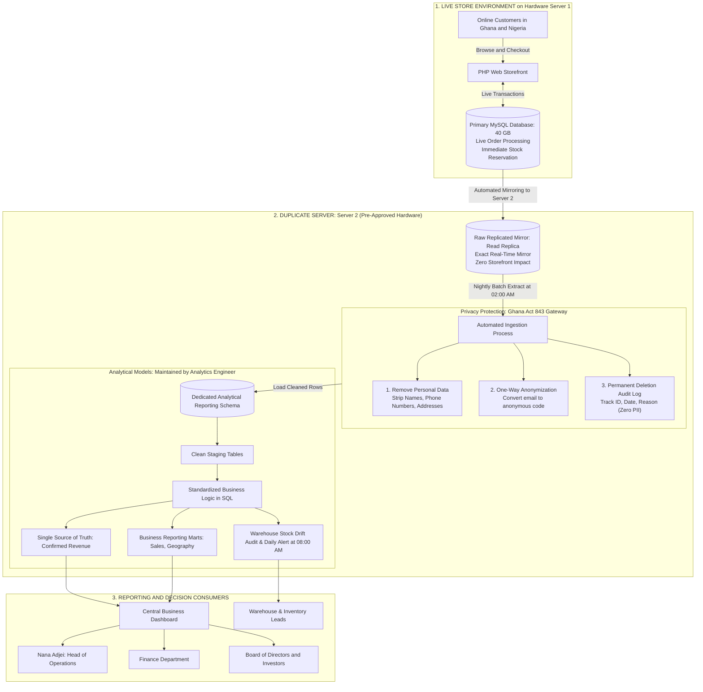

# System Architecture and Entity Relationship Diagrams: Kloud Kart

> **Note on this document:** This architectural diagram and the Entity Relationship Diagram below are not part of the required lab deliverables. They are included here to give you a clear, simple visual picture of all the moving parts, how they connect to each other, and how customer data is protected.

---

## 1. End-to-End System Component Architecture

The diagram below shows every technical component, the physical hardware boundaries, and the direction of data flow:

---

## 2. Entity Relationship Diagram: Operational vs. Analytical Schemas

The diagram below details the data tables of both the live operational store and the central reporting database, showing how business records connect:

```mermaid
erDiagram
    CUSTOMERS {
        int customer_id PK "Unique customer account ID"
        string full_name "Customer full name: Personal Data"
        string email_address "Customer email address: Personal Data"
        string phone_number "Mobile phone number: Personal Data"
        string street_address "Delivery address: Personal Data"
        string region "Ghana or Nigeria delivery region"
        string country_code "Country of origin"
        timestamp created_at "Registration timestamp"
        timestamp deleted_at "Deletion timestamp"
    }

    ORDERS {
        int order_id PK "Unique order tracking number"
        int customer_id FK "Customer who placed order"
        timestamp order_placed_at "Order placement timestamp"
        string order_status "Pending, Dispatched, Delivered, Returned"
        decimal total_order_value_ghs "Total transaction value in Cedis"
        string market_country "Ghana or Nigeria"
    }

    ORDER_ITEMS {
        int order_item_id PK "Unique line item record"
        int order_id FK "References parent order"
        int product_id FK "References purchased product"
        int quantity_purchased "Units of product ordered"
        decimal unit_price_at_checkout_ghs "Purchase price per unit"
    }

    PRODUCTS {
        int product_id PK "Unique stock keeping unit identifier"
        string product_title "Catalog product title"
        string product_category "Merchandise category"
        int physical_stock_available "CRITICAL: Live physical count: Zero staleness"
        decimal retail_price_ghs "Current store price"
    }

    CUSTOMERS ||--o{ ORDERS : "places"
    ORDERS ||--|{ ORDER_ITEMS : "contains"
    PRODUCTS ||--o{ ORDER_ITEMS : "ordered_in"

    DIM_CUSTOMER_ANONYMOUS {
        int customer_analytics_key PK "Internal warehouse surrogate key"
        int source_customer_id "Masked customer reference"
        string anonymous_account_code "Cryptographic one-way hash"
        string customer_delivery_region "Geographic territory"
        string customer_country "Ghana or Nigeria"
        date cohort_first_order_date "First purchase date"
    }

    DIM_PRODUCT {
        int product_analytics_key PK "Warehouse product surrogate key"
        int source_product_id "Original catalog SKU reference"
        string product_name "Standardized catalog title"
        string product_category "Category classification"
        decimal base_price_ghs "Standard retail price"
    }

    DIM_DATE {
        date date_calendar_key PK "Calendar date identifier"
        int calendar_year "Calendar year"
        int calendar_quarter "Financial quarter: Q1 to Q4"
        int calendar_month "Month number: 1 to 12"
        string month_name "Month name: January to December"
        int week_of_year "Week number: 1 to 52"
        boolean is_weekend_day "True if Saturday or Sunday"
    }

    FACT_ORDERS {
        int fact_order_id PK "Analytical order fact identifier"
        int order_id "Source order reference number"
        int customer_analytics_key FK "Links to Dim_Customer_Anonymous"
        int product_analytics_key FK "Links to Dim_Product"
        date order_date_key FK "Links to Dim_Date"
        int quantity "Item count ordered"
        decimal gross_sale_amount_ghs "Gross order cedi value"
        decimal net_sale_amount_ghs "Net cedi value after discounts"
        string canonical_revenue_status "DISPATCHED, SETTLED, or REFUNDED"
    }

    FACT_DAILY_REVENUE_RECONCILIATION {
        int reconciliation_id PK "Daily reconciliation ledger key"
        date business_date_key FK "Links to Dim_Date"
        string operating_country "Ghana or Nigeria"
        decimal operations_dispatched_total_ghs "Revenue from shipped orders"
        int operations_dispatched_order_count "Shipped order count"
        decimal finance_settled_total_ghs "Revenue settled in bank accounts"
        int finance_settled_transaction_count "Bank cleared transaction count"
        decimal variance_delta_ghs "Variance between Operations and Finance"
        string audit_reconciliation_status "MATCH or VARIANCE_INVESTIGATION"
    }

    FACT_INVENTORY_DRIFT_AUDIT {
        int audit_id PK "Unique inventory audit tracking key"
        date audit_date_key FK "Links to Dim_Date"
        int product_analytics_key FK "Links to Dim_Product"
        int physical_shelf_count "Physical count from warehouse scan"
        int system_stock_balance "Website operational stock balance"
        int variance_count "Difference between shelf and website"
        string drift_alert_status "NORMAL, MISMATCH_ALERT, or CORRECTED"
    }

    AUDIT_CUSTOMER_DELETION_LOG {
        int audit_deletion_id PK "Unique deletion event tracking key"
        int source_customer_id "Masked customer identifier"
        string action_type "REMOVAL or RESTORATION"
        date request_date "Date action request received"
        date completion_date "Date action verified across systems"
        string action_reason "Account closure, opt-out, or recovery"
        string regulatory_dpc_status "COMPLIANT_VERIFIED"
        boolean backup_reapplication_flag "True: Re-apply on restore"
    }

    DIM_CUSTOMER_ANONYMOUS ||--o{ FACT_ORDERS : "aggregates"
    DIM_CUSTOMER_ANONYMOUS ||--o{ AUDIT_CUSTOMER_DELETION_LOG : "audited_in"
    DIM_PRODUCT ||--o{ FACT_ORDERS : "aggregates"
    DIM_PRODUCT ||--o{ FACT_INVENTORY_DRIFT_AUDIT : "audited_in"
    DIM_DATE ||--o{ FACT_ORDERS : "timestamps"
    DIM_DATE ||--o{ FACT_DAILY_REVENUE_RECONCILIATION : "schedules"
    DIM_DATE ||--o{ FACT_INVENTORY_DRIFT_AUDIT : "schedules"
```

---

## 3. Data Cleaning and Privacy Mapping: The Sanitization Mechanism

The table below explains what happens to each operational field during the nightly transfer to the reporting database, showing how customer privacy is protected under Ghana's Data Protection Act, 2012 (Act 843):

| Source Table and Field | Operational Purpose | Action at Ingestion Boundary | Analytical Reporting Destination | Reason for Action |
|---|---|---|---|---|
| `CUSTOMERS.full_name` | Storefront greeting and parcel label | **Permanently Dropped** | *None* | Personal details are not needed to calculate business metrics. Removing names prevents legal risk under Act 843. |
| `CUSTOMERS.phone_number` | Delivery driver contact | **Permanently Dropped** | *None* | Personal contact information. Removing it keeps customer phones out of internal reports. |
| `CUSTOMERS.street_address` | Home delivery address | **Permanently Dropped** | *None* | High-risk personal identifier. High-level regional reports do not need street names. |
| `CUSTOMERS.email_address` | Account login and receipt email | **One-Way Anonymization** | `DIM_CUSTOMER_ANONYMOUS.anonymous_account_code` | Converts email into an unreadable random code (such as `cust_98234`), allowing repeat-purchase tracking without saving plain contact details. |
| `CUSTOMERS.region` | Shipping fee calculation | **Standardized and Saved** | `DIM_CUSTOMER_ANONYMOUS.delivery_region` | Needed for regional sales tracking across Greater Accra, Ashanti, and Nigerian states. |
| `ORDERS.total_amount_ghs` | Customer checkout total | **Transferred Raw** | `FACT_ORDERS.gross_sale_amount_ghs` | Standard financial metric. It must remain exact down to the pesewa for auditing. |
| `ORDERS.order_status` | Warehouse packing status | **Grouped into Agreed Business Status** | `FACT_ORDERS.canonical_revenue_status` | Standardized in SQL by the Analytics Engineer so Operations and Finance use the exact same definition. |
| `PRODUCTS.physical_stock_available` | Prevents selling items out of stock | **Live Checkout Check on Primary DB; Audited in Nightly Batch** | `FACT_INVENTORY_DRIFT_AUDIT.system_stock_balance` | Shelf counts must never be stale during checkout. Audited nightly against physical warehouse scans to flag drift at 08:00 AM before shoppers order. |

---

## 4. How All the Pieces Connect to Solve Kloud Kart's Business Problems

1. **How Website Slowdowns are Stopped:**
   - Shoppers browse and place orders on Server 1.
   - The primary database writes new customer orders.
   - The pre-approved second server automatically mirrors every transaction in real time.
   - All reports and exports run exclusively against the second server (the reporting mirror).
   - **Result:** Live shoppers never compete with staff reports for computer memory or processor speed.

2. **How Conflicting Revenue Numbers are Resolved:**
   - Both Nana Adjei and the Finance department stop exporting separate spreadsheet files.
   - The Analytics Engineer writes agreed business definitions directly in standard SQL database queries.
   - An automated daily check compares shipped orders against bank settlements every morning.
   - **Result:** Both teams look at the exact same dashboard and see the exact same revenue number.

3. **How Ghana Act 843 Compliance is Guaranteed:**
   - Raw spreadsheet downloads on staff laptops are stopped.
   - Names, phone numbers, and physical addresses are removed at the gate before data enters the reporting system.
   - Customer emails are turned into anonymous codes.
   - Every customer data action is recorded in a permanent audit log (tracking anonymous customer ID, request date, action type, and reason without storing personal details), enabling automated post-restore deletion re-application so historical backups never bring back erased personal records (removing), while permitting targeted recovery of order history via surrogate keys if an account was closed or contested in error (restoring).
   - Disaster recovery runbooks automatically re-apply customer deletions from the audit log to restored backups so historical backups never bring back erased personal records.
   - **Result:** Defensively solves both dimensions of the DPC complaint. When a customer asks for their personal data to be deleted, Kloud Kart only needs to delete the record from the primary store database. Zero personal customer records exist in the reporting database, meeting the 90-day implementation compliance target. If an account deletion is ever contested before the DPC or performed in error, the permanent audit log and surrogate key architecture enable targeted operational restoration of purchase history without ever leaking or bringing back raw personal contact details on employee laptops.

4. **How Warehouse Stock Accuracy and Overselling Prevention are Guaranteed:**
   - Online shoppers check inventory live against the primary database during checkout, guaranteeing zero stale stock counts.
   - During the 02:00 AM nightly batch window, an automated inventory drift check compares recorded physical warehouse scan logs against website stock balances.
   - If a mismatch is detected, the system alerts the warehouse team at 08:00 AM so they can investigate and correct shelf numbers before shoppers buy items that are sold out.
   - **Result:** Catches over 95% of stock mismatches before checkout, keeping out-of-stock order cancellations below 0.5% of total orders.
