# Architecture & Entity Relationship Diagrams — Kloud Kart

This document provides a visual and plain-English blueprint of all moving components in the recommended Kloud Kart data platform. It illustrates how data flows from customer checkout to executive dashboards, and how operational database entities connect to analytical reporting models.

---

## 1. End-to-End System Component Architecture

The diagram below maps every technical component, the physical hardware boundaries, and the direction of data flow:

```mermaid
flowchart TD
    subgraph LiveStore["1. LIVE STORE ENVIRONMENT (Hardware Server 1)"]
        Shoppers["Online Customers (Ghana & Nigeria)"] -->|Browse & Checkout| WebApp["PHP Web Storefront"]
        WebApp <-->|Instant ACID Transactions| PrimaryDB[("Primary MySQL Database (40 GB)<br/>- Live Order Processing<br/>- Immediate Stock Reservation")]
    end

    PrimaryDB -->|Automated Asynchronous Replication<br/>Pre-Approved Hardware Server 2| ReadReplica[("Duplicate Database Server (Read Replica)<br/>- Exact Real-Time Mirror<br/>- Zero Storefront Impact")]

    subgraph DataPlatform["2. DATA PLATFORM & PRIVACY GATEWAY"]
        ReadReplica -->|Nightly Automated Batch (02:00 AM)<br/>Extracts Changed Rows Only| IngestionScript["Automated Python Ingestion Engine"]
        
        subgraph PrivacyGateway["Privacy Sanitization (Ghana Act 843 Gateway)"]
            IngestionScript --> DropPII["1. Strip Personal Data<br/>(Names, Phone Numbers, Addresses)"]
            IngestionScript --> HashEmail["2. One-Way Anonymization<br/>(email -> cust_98234)"]
        end
        
        PrivacyGateway --> LoadClean["Load Anonymized Transactional Rows"]
        LoadClean --> WarehouseDB[("Central Relational Reporting Database")]
        
        subgraph WarehouseDB["Analytical Data Models (Written by Analytics Engineer)"]
            StagingTables["Staging Layer"] --> TransformationSQL["Standardized SQL Models (dbt)"]
            TransformationSQL --> CanonicalRevenue["Single Source of Truth: Canonical Revenue Mart"]
            TransformationSQL --> DimensionalMarts["Business Analytics Marts<br/>(Sales, Cohorts, Geography)"]
        end
    end

    subgraph ReportingConsumers["3. REPORTING & DECISION CONSUMERS"]
        CanonicalRevenue --> UnifiedDashboard["Central Business Dashboard (Metabase / BI)"]
        UnifiedDashboard --> NanaView["Nana Adjei (Head of Operations)"]
        UnifiedDashboard --> FinanceView["Finance Department (Reconciliation)"]
        UnifiedDashboard --> BoardView["Board of Directors & Investors"]
    end
```

---

## 2. Entity Relationship Diagram: Operational vs. Analytical Schemas

The Entity Relationship Diagram below details the schemas of both the live operational store and the central reporting warehouse, showing the exact relationships between business records:

```mermaid
erDiagram
    %% OPERATIONAL (TRANSACTIONAL) SCHEMA - Primary MySQL
    CUSTOMERS {
        int customer_id PK "Unique customer account ID"
        string full_name "Customer full name (Personal Data)"
        string email_address "Customer email address (Personal Data)"
        string phone_number "Mobile telephone number (Personal Data)"
        string street_address "Delivery residential address (Personal Data)"
        string region "Ghana / Nigeria delivery region"
        string country_code "Country of origin"
        timestamp created_at "Registration timestamp"
        timestamp deleted_at "Statutory right-to-erasure timestamp"
    }

    ORDERS {
        int order_id PK "Unique order tracking number"
        int customer_id FK "Customer who submitted order"
        timestamp order_placed_at "Order placement timestamp"
        string order_status "Pending, Dispatched, Delivered, Returned"
        decimal total_order_value_ghs "Total transaction value in Cedis"
        string market_country "Ghana or Nigeria"
    }

    ORDER_ITEMS {
        int order_item_id PK "Unique line item record"
        int order_id FK "References parent order"
        int product_id FK "References purchased product"
        int quantity_purchased "Units of product ordered"
        decimal unit_price_at_checkout_ghs "Purchase price per unit"
    }

    PRODUCTS {
        int product_id PK "Unique inventory SKU identifier"
        string product_title "Catalog product title"
        string product_category "Merchandise category"
        int physical_stock_available "CRITICAL: Live physical count (Zero staleness)"
        decimal retail_price_ghs "Current store price"
    }

    CUSTOMERS ||--o{ ORDERS : "places"
    ORDERS ||--|{ ORDER_ITEMS : "contains"
    PRODUCTS ||--o{ ORDER_ITEMS : "ordered_in"

    %% ANALYTICAL REPORTING SCHEMA - Central Warehouse Database
    DIM_CUSTOMER_ANONYMOUS {
        int customer_analytics_key PK "Internal warehouse surrogate key"
        int source_customer_id "Masked customer reference"
        string anonymous_account_code "Cryptographic one-way hash"
        string customer_delivery_region "Geographic territory"
        string customer_country "Ghana or Nigeria"
        date cohort_first_order_date "First purchase cohort date"
    }

    DIM_PRODUCT {
        int product_analytics_key PK "Warehouse product surrogate key"
        int source_product_id "Original catalog SKU reference"
        string product_name "Standardized catalog title"
        string product_category "Category classification"
        decimal base_price_ghs "Standard retail price"
    }

    DIM_DATE {
        date date_calendar_key PK "Calendar date identifier"
        int calendar_year "Calendar year (e.g., 2026)"
        int calendar_quarter "Financial quarter (Q1-Q4)"
        int calendar_month "Month number (1-12)"
        string month_name "Month name (January-December)"
        int week_of_year "Week number (1-52)"
        boolean is_weekend_day "True if Saturday or Sunday"
    }

    FACT_ORDERS {
        int fact_order_id PK "Analytical order fact identifier"
        int order_id "Source order reference number"
        int customer_analytics_key FK "Links to Dim_Customer_Anonymous"
        int product_analytics_key FK "Links to Dim_Product"
        date order_date_key FK "Links to Dim_Date"
        int quantity "Item count ordered"
        decimal gross_sale_amount_ghs "Gross order cedi value"
        decimal net_sale_amount_ghs "Net cedi value after discounts"
        string canonical_revenue_status "DISPATCHED, SETTLED, or REFUNDED"
    }

    FACT_DAILY_REVENUE_RECONCILIATION {
        int reconciliation_id PK "Daily reconciliation ledger key"
        date business_date_key FK "Links to Dim_Date"
        string operating_country "Ghana or Nigeria"
        decimal operations_dispatched_total_ghs "Total revenue from shipped orders"
        int operations_dispatched_order_count "Total shipped order count"
        decimal finance_settled_total_ghs "Total revenue settled in bank accounts"
        int finance_settled_transaction_count "Total bank-cleared transaction count"
        decimal variance_delta_ghs "Variance between Operations and Finance"
        string audit_reconciliation_status "MATCH or VARIANCE_INVESTIGATION"
    }

    DIM_CUSTOMER_ANONYMOUS ||--o{ FACT_ORDERS : "aggregates"
    DIM_PRODUCT ||--o{ FACT_ORDERS : "aggregates"
    DIM_DATE ||--o{ FACT_ORDERS : "timestamps"
    DIM_DATE ||--o{ FACT_DAILY_REVENUE_RECONCILIATION : "schedules"
```



---

## 3. Data Transformation & Privacy Mapping: The Sanitization Mechanism

The table below explains exactly what happens to each operational field during the nightly transfer to the reporting warehouse, illustrating how customer privacy is protected under Ghana's Data Protection Act, 2012 (Act 843):

| Source Table & Field | Operational Purpose | Action at Ingestion Boundary | Analytical Reporting Destination | Reason for Intervention |
|---|---|---|---|---|
| `CUSTOMERS.full_name` | Storefront greeting & packaging | **Permanently Dropped** | *None* | Personal information not required for business metrics; prevents regulatory liability under Act 843. |
| `CUSTOMERS.phone_number` | Delivery courier contact | **Permanently Dropped** | *None* | Direct personal identifier; removing it protects customer privacy from analytical access. |
| `CUSTOMERS.street_address` | Home package delivery | **Permanently Dropped** | *None* | High-risk personal identifier; unnecessary for high-level regional market analysis. |
| `CUSTOMERS.email_address` | Account login & order receipt | **One-Way Cryptographic Hash** | `DIM_CUSTOMER_ANONYMOUS.anonymous_account_code` | Converts email into an unreadable string (`cust_98234`) allowing cohort and repeat-purchase analysis without storing raw contact info. |
| `CUSTOMERS.region` | Shipping zone calculation | **Standardized & Retained** | `DIM_CUSTOMER_ANONYMOUS.delivery_region` | Essential for regional sales tracking across Greater Accra, Ashanti, and Nigerian states. |
| `ORDERS.total_amount_ghs` | Customer checkout charge | **Transferred Raw** | `FACT_ORDERS.gross_sale_amount_ghs` | Quantitative business metric; must remain exact down to the pesewa for financial auditing. |
| `ORDERS.order_status` | Warehouse fulfillment state | **Classified into Canonical Metric** | `FACT_ORDERS.canonical_revenue_status` | Standardized in SQL by the Analytics Engineer so Operations and Finance use the exact same definition. |
| `PRODUCTS.physical_stock_available` | Prevents overselling | **Kept Live on Primary DB Only** | *Excluded from Nightly Batch* | Inventory reservations must never go stale; queried live on primary database to guarantee zero overselling. |

---

## 4. How All the Pieces Connect to Solve Kloud Kart's Business Problems

1. **How Website Slowdowns are Stopped:**
   - Shoppers connect to the PHP storefront on Server 1.
   - The primary MySQL database writes new customer orders.
   - The pre-approved second server automatically mirrors every transaction in real-time.
   - The automated nightly extraction runs exclusively against Server 2 at 02:00 AM.
   - **Result:** Live shoppers never compete with analytical queries for memory or processor power.

2. **How Conflicting Revenue Numbers are Resolved:**
   - Both Nana and the Finance department stop exporting private CSV spreadsheets.
   - The Analytics Engineer models `FACT_DAILY_REVENUE_RECONCILIATION` in standard SQL queries.
   - The automated daily reconciliation engine matches shipped orders against bank settlements every morning at 08:00 AM.
   - **Result:** Both teams open their dashboards and view the exact same revenue number, reconciled down to the cedi.

3. **How Ghana Act 843 Compliance is Guaranteed:**
   - Unmanaged CSV downloads on staff laptops are eliminated.
   - Direct personal identifiers (names, phone numbers, addresses) are stripped at the gate.
   - Customer emails are converted to anonymous codes.
   - **Result:** When a customer requests deletion, Kloud Kart only needs to delete the record in the primary operational database; zero personal customer data exists in the reporting warehouse, meeting the 90-day statutory audit standard with 100% confidence.
